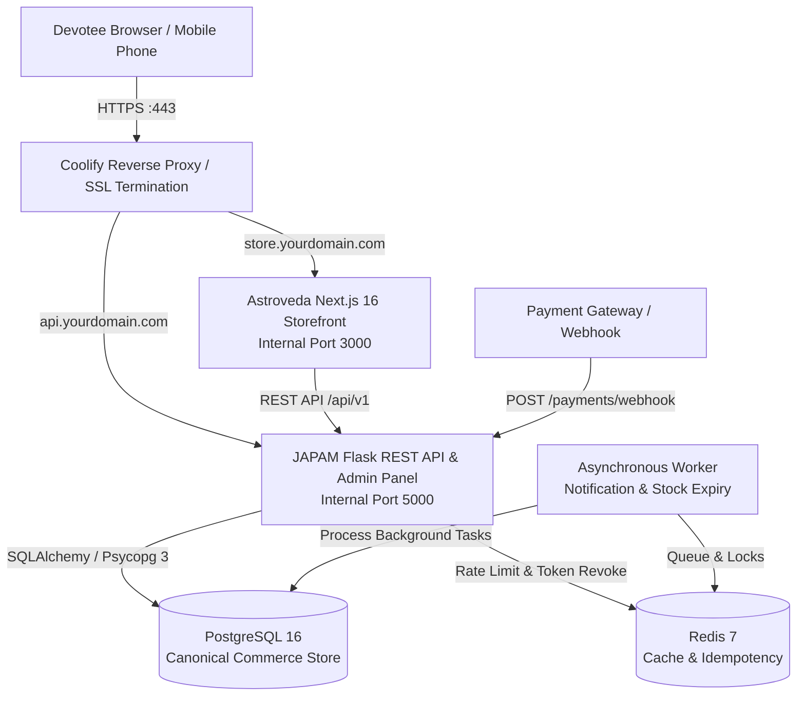

# System Architecture: Astroveda + JAPAM Spiritual Platform

## 1. Overview & Core Philosophy
The platform merges two specialized codebases into a high-reliability, spiritually elevated e-commerce and Vedic consultation system:
- **Astroveda (Frontend Storefront):** A modern Next.js 16 App Router customer application presenting sacred items (Rudraksha, Ratna, Yantra, Bracelets), Vedic astrology consultations, and traditional puja services with authentic Marathi/Sanskrit spiritual aesthetics.
- **JAPAM (Backend & Admin Control Plane):** A Python Flask application providing an authoritative REST API (`/api/v1`), role-based administrative dashboard, atomic commerce operations, stock reservations, order lifecycle management, and background worker jobs.

---

## 2. Component Topology & Service Boundaries

---

## 3. Trust Boundaries & Separation of Concerns

| Concern | Authoritative Service | Rule |
| :--- | :--- | :--- |
| **Product Prices & Taxes** | JAPAM Flask Backend | The client browser **never** decides prices, discounts, taxes, or final payable amounts. `/api/v1/cart/calculate` and `/api/v1/orders/checkout` calculate all figures using `Decimal` fixed precision. |
| **Stock & Reservations** | JAPAM Flask Backend | Decrements and checks are performed inside atomic database transactions using `with_for_update()` row locking. Stock is restored if an order is cancelled or expires. |
| **Devotee Order Access** | JAPAM Flask Backend | Orders are protected by a 256-bit cryptographically secure `access_token` generated upon checkout. Merely knowing an email address or guessing an order number does **not** grant authorization (Insecure Direct Object Reference / IDOR protected). |
| **Admin Operations** | JAPAM Admin Panel / JWT | Admin endpoints require session authentication or `Bearer` JWT tokens verified against role-based access control (RBAC). |
| **Presentation & Visuals** | Astroveda Next.js | Handles responsive rendering, sacred SVG aura glyphs, Devanagari typography, cart state synchronization, and client-side form validation. |

---

## 4. Key Data Flows

### A. Catalog & Product Details
1. Devotee visits Astroveda storefront.
2. Next.js components render the sacred catalog via `lib/products.js`, backed by `adaptApiProduct()`.
3. If connected to JAPAM API (`/api/v1/catalog/products`), dynamic stock availability and admin pricing updates are immediately reflected.

### B. Cart & Authoritative Price Calculation
1. Devotee adds products by canonical backend ID (`id: 3`, `id: 10`, etc.).
2. When items are modified or a coupon is entered, the storefront calls `POST /api/v1/cart/calculate` with `{ items: [{ product_id, quantity }], coupon_code }`.
3. The Flask API queries the database, verifies published status, checks stock availability, calculates subtotal, checks coupon validity and minimum order requirements, applies 3% Vedic goods GST, sets courier shipping (Free over ₹999, else ₹99), and returns authoritative totals.

### C. Atomic Checkout & Payment
1. Devotee enters Name, Email, Mobile Number, Shipping Address, and selects Payment Method (Razorpay or Cash on Delivery).
2. Storefront generates a random `Idempotency-Key` and issues `POST /api/v1/orders/checkout`.
3. Flask acquires row locks (`with_for_update()`) on product records, reserves inventory atomically, verifies customer data, generates collision-safe order number (`#ORD-YYMMDDHHMM-XXXX`), creates the order and order items, and returns `order_number` and `access_token`.
4. The storefront stores `access_token` in `localStorage` (`astroveda_order_tokens`), clears the cart, and displays the confirmation screen.

### D. Webhook Ingestion & Idempotency
1. Payment gateway (Razorpay) dispatches `payment.captured` event to `POST /api/v1/payments/webhook`.
2. Flask verifies HMAC-SHA256 signature using `PAYMENT_WEBHOOK_SECRET` with constant-time `hmac.compare_digest`. If secret is missing, it fails closed with HTTP 500.
3. Event ID is checked in Redis (`wh:event:<id>`) for 24-hour duplicate suppression.
4. Total amount in paise is strictly verified against order total.
5. Order status transitions to `paid` and `processing`, and a `PaymentTransaction` record is persisted.
